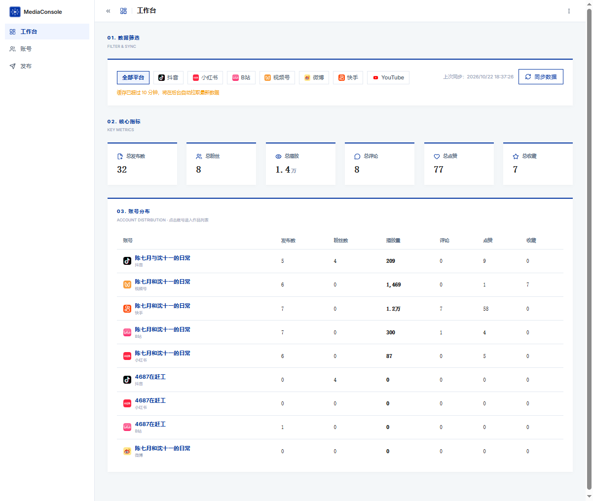
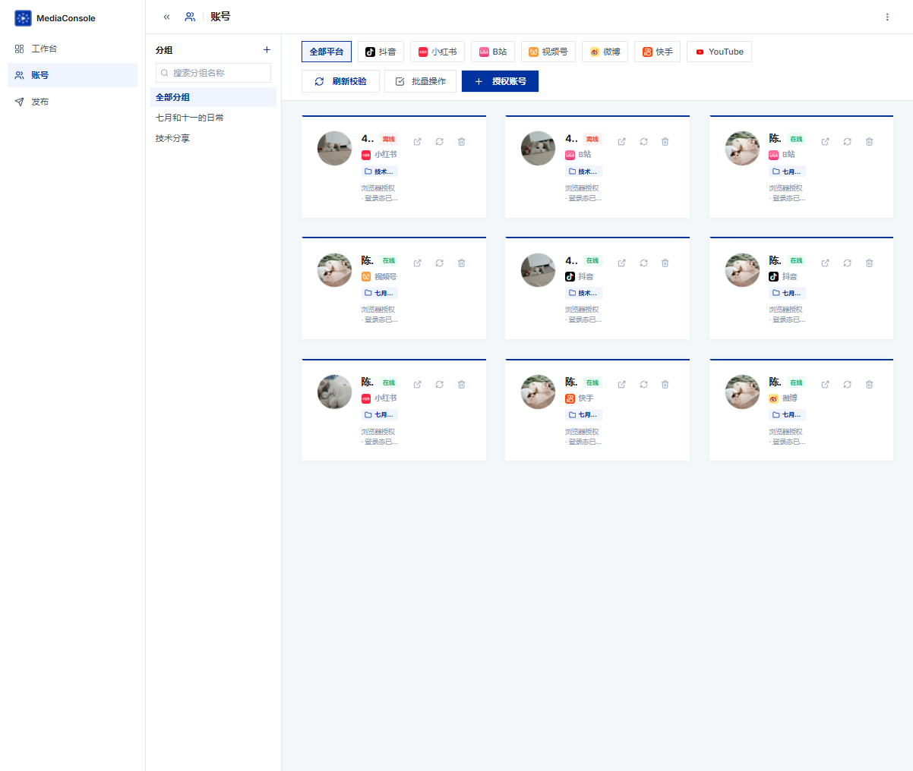
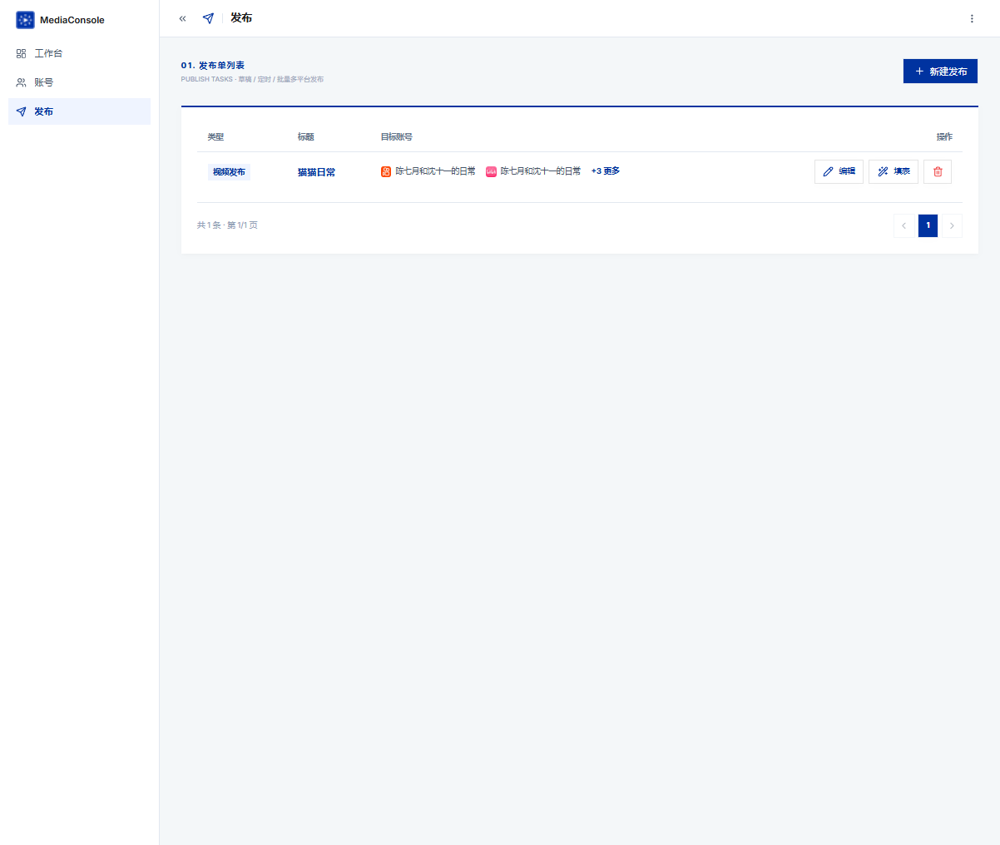
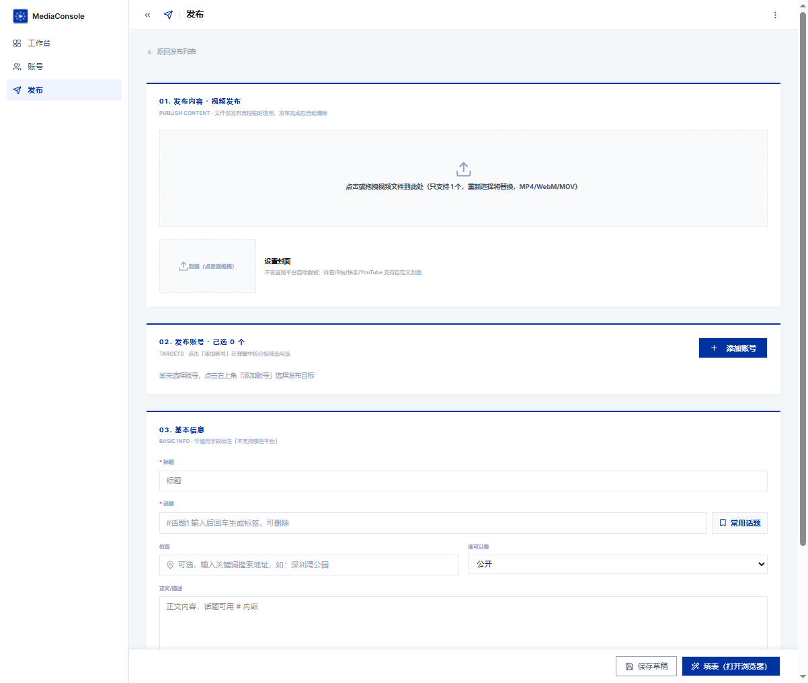
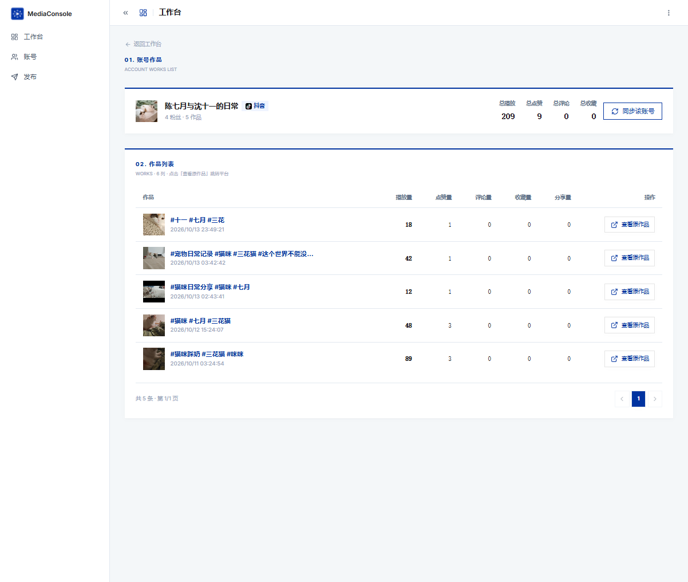

# MediaConsole · 自媒体多平台管理系统

> 一人运营多平台账号的桌面级管理工具：账号矩阵、内容创作与多平台适配、自动填表发布、数据复盘看板，一套搞定 7 个主流平台。

支持平台：**抖音 · 小红书 · B站 · 视频号 · 微博 · 快手 · YouTube**

---

## ✨ 功能特性

### 1. 多平台账号矩阵
- 7 大平台账号统一管理：卡片式展示在线/离线状态、登录态校验
- 分组管理（自定义分组 + 搜索）、平台筛选、批量操作
- 一键「授权账号」：Playwright 打开平台登录页完成授权，登录态本地持久化
- 「浏览授权/登录日志」：随时检查各平台登录态有效期

### 2. 内容创作与多平台适配
- 新建发布单，按平台差异自动适配：话题/标签、位置、可见范围、B站分区/创作声明等平台专属字段
- 多平台一键勾选目标账号，发布单统一管理（草稿 / 定时 / 批量多平台）

### 3. 自动填表发布
- 一条发布单批量打开各平台创作中心并**自动填写表单**（视频/图文）
- 平台差异化处理：标题、话题、封面、声明等按平台规则填入
- 填表窗口保持打开，人工确认后发布，全程可见可控

### 4. 数据复盘看板
- 全平台核心指标总览（发布数/粉丝/播放/评论/点赞/收藏）
- 账号维度分布明细，点击进入单个账号作品列表
- 作品级数据：播放量、点赞、评论、收藏、分享，一键跳转平台原作品

## 📸 界面截图

**工作台 · 数据看板**



**账号管理**



**发布单列表**



**视频发布编辑器**



**账号作品列表**



---

## 🛠 技术栈

| 层 | 技术 |
|---|---|
| 前端 | React 19 · TypeScript · Vite 8 · Tailwind CSS 4 · shadcn/ui · ECharts 6 |
| 后端 | NestJS 10 · TypeScript · Express |
| 数据 | PostgreSQL · Drizzle ORM |
| 自动化 | Playwright（自动填表 / 授权 / 数据同步） |
| 桌面端 | Tauri 2（Rust + WebView2） |
| 其他 | React Router 7 · Radix UI · Lucide Icons |

## 🚀 快速开始

### 环境要求

- Node.js ≥ 22、pnpm ≥ 10
- Rust 工具链（仅打包桌面端需要）
- PostgreSQL（推荐 1Panel 部署；或任意可达的 Postgres）
- Windows 10/11（自动填表使用系统 Edge 浏览器）

### 1. 安装依赖

```bash
pnpm install
```

### 2. 配置数据库

后端通过环境变量 `SUDA_DATABASE_URL` 连接 PostgreSQL，配置在用户级文件（默认路径）：

```
%APPDATA%\SocialManager\env.local
```

```ini
SUDA_DATABASE_URL=postgres://<用户名>:<密码>@<主机>:5432/social_app
```

首次启动会自动建表（`db/init.sql` 为建表参考）。

### 3. 开发模式（前后端热更新）

```bash
npm run dev
```

### 4. 生产构建与运行

```bash
# 构建（服务端 + 前端）
npm run build:prod

# 运行（生产模式）
cd dist && node server/main.js
```

### 5. 打包桌面端（可选）

```bash
# 打包 Windows 安装包（Tauri）
npm run build:exe        # 完整打包
npm run build:exe:fast   # 快速打包（复用缓存）
```

---

## 📂 目录结构

```
├── client/                 # 前端（React + Vite）
│   └── src/
│       ├── pages/          # 页面：工作台/账号/发布/作品/素材
│       └── components/     # 通用组件
├── server/                 # 后端（NestJS）
│   └── modules/social/     # 核心业务模块
│       ├── accounts/       # 账号矩阵与授权
│       ├── contents/       # 内容与作品数据
│       ├── metrics/        # 数据指标
│       └── publish/        # 发布单 / 自动填表（fill/）
├── shared/                 # 前后端共享契约（类型、平台常量）
├── db/                     # 数据库初始化 SQL
├── scripts/                # 构建与辅助脚本
├── src-tauri/              # Tauri 桌面端壳
└── screenshots/            # 文档截图
```

## ⚠️ 说明

- **登录态与数据安全**：平台账号登录态、数据库连接串等敏感配置存放于 `%APPDATA%\SocialManager\`，不入库；仓库内所有连接信息均为占位符。
- **自动填表**依赖 Playwright 以有头模式打开各平台创作中心，需要本机可访问目标平台。

## 📄 License

本项目采用 **CC BY-NC 4.0**（署名-非商业性使用）许可：

- ✅ 允许：学习、研究、个人使用、修改、在注明出处的前提下分享
- ❌ 禁止：任何形式的**商业用途**（含盈利性代运营、售卖服务/成品、商业环境内部使用等）

完整条款见 [LICENSE](LICENSE)。

Copyright © 2026 MediaConsole Contributors
